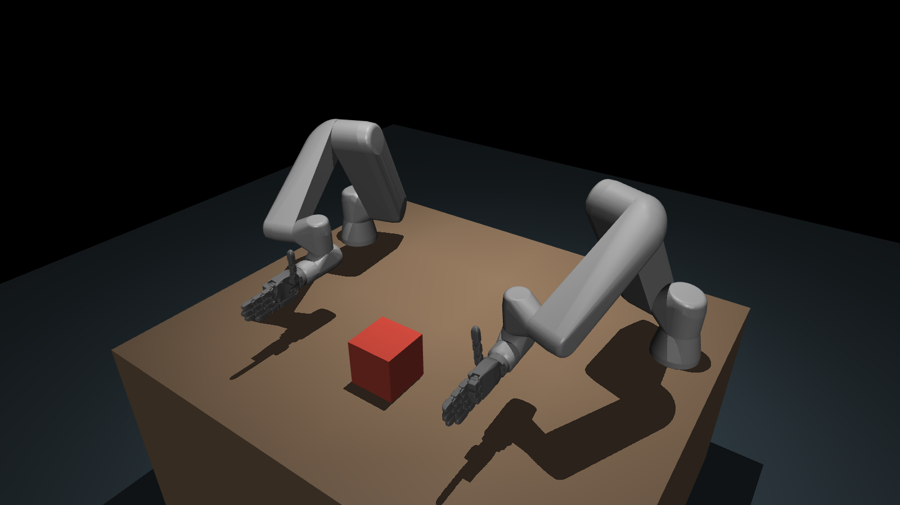

# bimanual-dg5fs



Twin of Nando's bimanual setup (`../robohand-master_wsl3`, the *Reference setup*):
two UR5e Arms, each carrying a 20-DOF Tesollo DG-5F-S Hand, for teleoperation and
policy training. Vocabulary is defined in [CONTEXT.md](CONTEXT.md); design
decisions are in [docs/adr/](docs/adr/).

- **Scene** (`src/bimanual_dg5fs/scene.py`): both Limbs, Table and Object in MuJoCo, also loadable in Newton.
- **Teleoperation in the Scene** with two MANUS Gloves and one camera: see
  [teleoperation/README.md](teleoperation/README.md).
- **RL training** in Isaac Lab, imitating recorded Demonstrations: see
  [training/README.md](training/README.md).

No real-robot drivers yet. The image is regenerated with `scripts/render_setup.py`.

## Setup

```bash
uv sync
```

Python 3.12; mujoco 3.12.0, newton 1.6.0rc1, mujoco-warp 3.12.0, warp 1.17.0
(same versions as `simtoolreal_newton`), plus mink.

If ROS 2 is sourced in your shell, its Python 3.10 packages on `PYTHONPATH`
break this environment. Prefix commands with `env -u PYTHONPATH`, as below.

## Run

```bash
env -u PYTHONPATH uv run scripts/view_scene.py      # MuJoCo viewer, Home pose; joint sliders in the Control panel
env -u PYTHONPATH uv run scripts/newton_smoke.py    # headless: both Limbs load and step in Newton
env -u PYTHONPATH uv run pytest                     # Scene + equivalence with the Reference setup
```

## Layout

```
assets/
  ur5e_left_dg5fs.urdf, ur5e_right_dg5fs.urdf   Limbs: source of truth (ADR 0001), edited by hand
  ur5e/{visual,collision}/                       UR5e meshes (Universal_Robots_ROS2_Description, via simtoolreal_newton)
  dg5fs/dg5fs_{left,right}/, dg5fs/LICENSE       DG-5F-S meshes, tesollodelto/tesollo_model @ dc8e11d (BSD-3)
src/bimanual_dg5fs/scene.py                      builds the Scene (MuJoCo): placement, Table, Object, actuators, Home
scripts/                                         viewer, Newton smoke test
tests/                                           Scene checks; equivalence with the Reference Arms
tests/fixtures/reference_scene/                  Reference bimanual_scene_cube.xml + UR5e MJCF (meshes omitted)
```

## How the Scene is put together

- **Limbs**: each URDF is the official UR5e (real joint limits) with the DG-5F-S
  `_w_mount` hand fixed to `tool0` by `mount_joint`.
- **Sides** are named from this Twin's operator position, opposite to Nando's: our
  **right** Limb is the Reference `ur5_1` Arm (x = -0.66, "left" in Nando's code) with
  the right Hand; our **left** Limb is `ur5_2` (x = +0.66) with the left Hand.
- **Base poses** are the Reference ones made mirror-symmetric about x = 0 and set on
  the Table top: (∓0.66, 0, 0.02). The Reference had (-0.66, 0, 0.04) and
  (0.66, -0.005, 0.02). They are poses
  of the UR controller base frame, which is the URDF link `base`; the URDF's
  `base_link` is rotated by pi from it, so the Scene adds that yaw when it places
  each Limb. Joint angles therefore mean the same as on the real Arms and in the
  Reference teleop scripts.
- **Home pose**: the right Limb takes the Reference default `HOME_POSES[0.55]`
  (`ur5_1`) with `wrist_2` +90 deg, so the Hand points forward (-y) instead of at the
  other Hand, and `wrist_3` -180 deg, so the thumb points up. The left Limb is its
  mirror image: `q_left = (2pi, -pi, 0, pi, 0, pi) - q_right` (`scene.mirror_arm_q`).
  Hands open.
- **Actuators**: one position actuator per joint (52). Arm gains are the Reference
  MJCF's; Hand gains are placeholders. Gravity is compensated on the Limbs, as
  the real controllers and the training stack do.
- **Contacts**: on between Limbs, Hands, Table and Object; excluded only for
  same-Limb bodies that touch at rest.
- MuJoCo cannot read the `.dae` visual meshes, so the viewer shows the collision meshes.

## Equivalence with the Reference setup

`tests/test_reference_equivalence.py` checks, at the same joint angles:

- each Limb's URDF `base` frame has the Reference base orientation exactly (position
  differs by the symmetrisation, < 2.5 cm);
- relative to its base, each `tool0` matches the Reference flange (0.1 m along `wrist_3_link` y; note that
  the Reference `attachment_site` is at the wrist_3 joint, not the flange) within
  0.1 deg and **2 mm**. The ~1.2 mm residual comes from the Reference's Menagerie
  UR5e rounding link lengths (0.163 / 0.392 / 0.1 / 0.1 m) where the official URDF
  uses UR's nominal values (0.1625 / 0.3922 / 0.0997 / 0.0996 m).

## Placeholders (to measure on the real rig)

| What | Where | Current value |
|---|---|---|
| Mount yaw, per Side | `mount_joint` in each Limb URDF | 0 rad |
| Table size, height, position | `scene.py` `TABLE_*` | 1.6 x 1.4 x 0.75 m, top at z = 0.02 (Arm base plane), 0.4 m behind the bases, 1.0 m in front |
| Object mass / start | `scene.py` `OBJECT_*` | 0.2 kg, on the Table between the palms (0, -0.60) |
| Hand drive gains | `scene.py` `HAND_KP/KV/ARMATURE` | 5 / 0.1 / 0.005 |

Tesollo notes that the DG-5F-S model parameters may change; its URDF masses
(~1.05 kg per Hand) are above the 880 g product spec.
